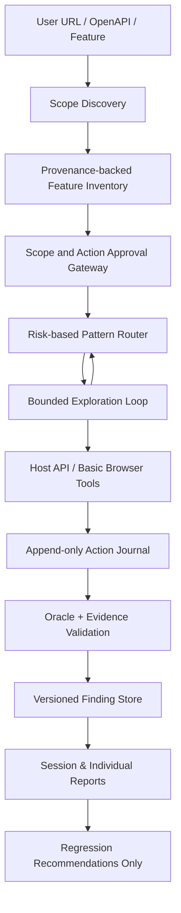

# BugMaster 最终开发基线总规范 v1.0（中文权威）

> **状态：工程基线定稿 / 产品尚未实现完成 / Release No-Go。** 本文件整合 Q1–Q17、全量品牌变更、测试对象范围 B、后续讨论中已经确定的自主范围发现、判定规则、报告与强 TDD。未声称已完成尚无实测证据的能力。

## 目录
1. 品牌、定位及用户目标
2. 最终决策与边界
3. 用户安装和使用（目标体验）
4. 技术架构和数据流
5. 自主发现测试范围
6. 测试入口分类与跨层归因
7. 判定真实 Bug 的规则体系
8. 自主探索循环和工具安全
9. 证据、Finding、Session 与去重
10. 两类报告与覆盖率概念
11. 11 Skills 和 16 Patterns
12. 产品目录、接口、数据契约
13. 工程规范、强 TDD 和覆盖率
14. 50 Benchmark 与真实价值验证
15. Release、安全及供应链
16. W0–W11 实施与风险台账
17. 阻断验收与已实现状态
18. 文档导航与 GitHub 启动操作

## 1. 品牌、定位及用户目标
- 品牌：**BugMaster（Bug 大师）**。
- 对外英文说明：**Evidence-driven Bug Discovery Skills for AI Agents**。
- 中文说明：面向 Agent 的证据驱动软件缺陷探索、验证与报告 Skills。
- 仓库：`AI-Native-QA-Lab/bugmaster`（尚未创建或验证可用）；工作区：`.bugmaster/`。
- 本包所有公开名称、缩写、路径均使用新品牌；**不建立旧品牌兼容别名**。Pattern/Finding 稳定 ID 和 Q/ADR 序号保留；尚未公开发布的 11 个 Skill ID 已统一迁移，不保留旧 ID。
- 产品定位：Agent 宿主上的独立 Skills Bundle，不是独立后台 Agent Runtime、安全扫描器、自动修复服务或 QA 可视化平台。
- 核心价值：用户不指定具体测试点时，也能发现可测试功能并解释测试选择，在授权范围内动态探索，以 Oracle/证据验证缺陷，生成适合 QA、开发及项目负责人复核的报告。

## 2. 最终决策与范围
正式决策序列：`Q1=A Q2=A Q3=B Q4=B Q5=B Q6=B Q7=B Q8=B Q9=A Q10=B Q11=B Q12=B Q13=B Q14=A Q15=D Q16=B Q17=A`。Q15 于 2026-11-22 由项目所有者修订；详见 [决策冻结](DECISION_FREEZE_Q1_Q17_ZH.md) 与 [ADR-015](ADR-015-risk-based-dual-review.md)。

**一次性交付的完整 v0.1**：11 Skills、16 Pattern 规则、50 个真实可执行 Benchmark、Codex 与 Claude Code 两宿主真实验证、REST/JSON/OpenAPI 优先及 Browser Basic、证据门禁、Session/Journal 安全恢复、独立安装、Go/No-Go 发布门禁。

**不纳入**：Android/iOS 原生设备驱动（仅 Test Surface 模型预留）、GraphQL/gRPC 完整执行适配、安全渗透或漏洞赏金、自动生成测试代码或代码修复、Web 管理台、后台无限循环。Q9 只给回归建议。

## 3. 最终用户体验（尚待实现与验证）
### 3.1 目标安装
```bash
npx skills add https://github.com/AI-Native-QA-Lab/bugmaster -g -a codex
```
仅是**目标命令**：正式 GitHub 仓库未创建且尚未完成双宿主实际安装验证，不得宣称现在可用。应支持完整 Bundle 与独立 Skill 安装、中文说明、多种风险模式，宿主决定实际工具执行。

### 3.2 输入示例
- “使用 BugMaster 探索已授权的本地网站 `http://localhost:3000`，请自主确定测试功能，先规划和请求写操作授权，最终出报告。”
- “对这份 OpenAPI 做风险驱动探索，识别需要优先验证的契约、边界和幂等性。”
- “验证订单取消后再支付是否违反状态机，收集可追溯证据。”

用户只给 URL 不提供任何功能点时，系统要完成：**只读且获授权的入口识别→功能地图→待确认 Scope→风险排序→有边界动态执行→判定→报告**。URL 不等于授权，不能默认扫描网站其他域、账号管理后台或破坏性写接口。

## 4. 技术架构

- Portable Core 保留纯数据契约和确定性验证，Host Adapter 只实现宿主 API/Browser/命令映射。
- 独立 Skill 打包必须包含所引用的 Pattern、模板和契约，不能依赖源仓库其他项目。
- 采用本地文件和版本化 JSON/Markdown 记录。MVP 不强制 DB、Server、Web UI。
- 规则与运行数据分离；前者版本化，后者在 `.bugmaster/` 中持久化并维护证据摘要。

## 5. 自主范围发现（Scope Discovery）
### 5.1 三个不能混淆的事实
| 记录 | 可能的状态 | 说明 |
|---|---|---|
| Feature Inventory | discovered / unknown | 仅能写入有真实发现来源的功能，不能凭框架推测功能存在 |
| Authorization Scope | in_scope / out_of_scope / pending_authorization | 独立审批，携带目标、身份、动作、预算、环境和 scope revision |
| Execution Coverage | planned / explored / partially_explored / blocked / not_explored | 关联 Action Journal，不能拿链接或计划冒充执行 |

### 5.2 API 发现
有 OpenAPI 时识别 paths/methods/parameters/schema/responses/authentication，并从实际数据/资源关系提出候选业务流。只有 Endpoint 时只围绕这个 Endpoint 做允许的契约和输入探索，不猜测整个 API 地图。写请求需 R2 审批与隔离工具限制。禁止把错误响应直接解释为 Bug，先检查契约和当前环境。

### 5.3 Web 发现
从授权起点识别站内导航、页面、表单、公开交互及网络请求，建立功能树。登录后的资源、跨域入口、写操作要重新按 scope 判断。不会执行未授权爬站、高频压测或外部真实交易。

### 5.4 动态风险排序
候选启发式：Priority = 0.30 业务影响 + 0.25 失败风险 + 0.20 复杂度 + 0.15 可观测性 + 0.10 未知度；每项归一到 0..5，记录评分依据。它不是缺陷概率；无 Oracle 时优先收集需求，而不是确认 Bug。

## 6. 测试入口、层次和未来 APP
| 入口 / Test Surface | v0.1 可执行 | 可能的问题类型 |
|---|---|---|
| `api` REST/JSON | 是（需真实宿主验证） | 契约、输入边界、状态与幂等、持久化结果 |
| `web` Browser Basic | 是（需真实宿主验证） | 页面导航、表单、重复交互、UI/API 一致性 |
| `android` | 否，仅分类保留 | 未来生命周期、权限、设备操作 |
| `ios` | 否，仅分类保留 | 未来生命周期、权限、设备操作 |

**观察入口不是根因层次**：记录 `testSurface`、`observedLayer`、`failureType`、`suspectedComponent`、`rootCauseStatus`、`evidenceRefs`。同一个订单“取消成功但状态未变”可能是 UI 缓存、API 契约、异步延迟或后端状态机问题；应沿相关请求、业务规则、权威状态和异步窗口验证，无法确认时 rootCauseStatus=unknown。

## 7. Bug 判定规则体系（必须可查看）
**Pattern → Oracle → Validation Gate** 三层职责不同：
1. **Pattern**：枚举可证伪风险，指导尝试；不能直接把观察到的异常认定为 Bug。
2. **Oracle**：引用版本化 OpenAPI、已确认需求、状态机或业务不变量；它定义**什么行为算违反预期**。缺 Oracle 时只输出待核实假设。
3. **Evidence/Validation Gate**：要求执行来源（不是模型自述）、工具响应、权威状态、因果与环境检查、必要复现和人类 Review。只有满足策略的 E3+ 方可确认。

### 7.1 API 规则实例：`BP-API-002` 幂等
**前提**：被测接口契约明确支持幂等键；相同键对应同一逻辑操作；有可查询的权威持久化状态。
**实验**：在隔离账号与授权范围下以同键等价 payload 重试，查询订单 ID/数量/业务状态。
**Oracle**：幂等契约不允许额外副作用。
**确认条件**：额外持久化副作用被真实观察到且已经排除请求不等价、不同逻辑操作、异步最终一致性窗口、脏数据、重放未知结果等反例。
**不确认**：不存在幂等契约、只观察到 HTTP 200、没有权威后状态、异常操作被授权网关阻断。

### 7.2 Web UI 规则实例
若表单提示成功却无法在权威后端状态证实，应先判断是否被允许异步延迟、前端缓存与后端响应契约所解释。若实际违背确认的 UI/API 一致性 Oracle，生成待归因 Finding 并关联网络和 UI 证据，而非自动归咎前端。

### 7.3 业务规则实例
优惠券重复核销、金额舍入和取消终态修改等必须以明确业务策略为 Oracle。未定义复合优惠规则时，不能用“常见电商规则”替代项目的业务约定。

### 7.4 规则文件与治理
- 人类可读说明：[中文判定规则](../zh-CN/11-bug-judgment-rules.md)。
- 机器规则：`patterns/<domain>/<BP-ID>/pattern.json`。
- 分类/路由：`patterns/taxonomy.json`、`registry/capabilities.json`。
- 16 项当前属于 Candidate，需要逐个补齐适用与不适用条件、实验、有效 Oracle、误报检查、正常与缺陷双版本实际 Eval，评审后方可升级 Verified。

## 8. 自主探索循环及安全
`hypothesis → choose legal experiment → approve if needed → execute → observe → evaluate Oracle/evidence → update scope and risk → continue/stop`。循环必须可停止、预算有限、可追溯，而不是无限点击。
- R0：只读、按 scope；R1：隔离安全；R2：可变更状态，仅在真实强制网关绑定审批摘要/目标/范围/预算后执行；R3：默认禁止。
- 发现新的端点不自动增加授权；未知动作结果先对账，禁止盲目重放；审批不得跨 scope revision 重用。
- 工作台允许 Guided、Assisted、Bounded Autonomous，但“自治”是宿主执行期间的有界循环，不是项目独立后台服务。

## 9. 证据、Finding、Session、去重
- E0 假设、E1 观察、E2 有支撑、E3 已验证、E4 独立验证（可选），证据等级和严重度、信心分开。
- Confirmed 必须验证 Oracle，满足执行来源、环境因果门禁、策略要求的人类确认；否则保持 suspected/needs_review。
- Finding 是结构化 SSOT，修订不可变并保留证据原件摘要；Markdown 报告派生；摘要只证明完整性不证明真实性。
- 跨 Web/API 发现同一个副作用：建立证据关联、同一业务事务/状态的 canonical Finding，保留两入口单独 trace；仅同类错误文本不能去重。
- Session 包含 Action Journal、scope 修订历史、权限、预算和断点；恢复时不自动重复未知副作用动作。

## 10. 报告与覆盖
**Session Exploratory Testing Report**：项目/环境/宿主/时间、功能地图来源、候选范围、授权与排除、风险排序理由、已探索/部分/阻断/未探索功能、实际动作/Oracle/Pattern、按 API/Web/业务分组且跨端去重的 Confirmed 与 Suspected、限制、剩余风险与下一步。

**Individual Finding Report**：业务背景、实际与预期、来源/Oracle 版本、复现前置条件、准确动作、工具/业务状态证据、严重度/置信/状态、问题责任层猜测与验证程度、整改/回归建议。

实际执行的业务功能覆盖不是覆盖所有场景；“本轮未发现 Bug”绝不等于测试全部通过。报告中统计项目范围覆盖时，使用实际执行 Action ID 关联 Feature，而不是自然语言推断。

## 11. 11 Skills、16 Patterns
11 个固定 Skill IDs：
`bug-discovery`, `discover-business-logic`, `discover-boundary-defects`, `discover-state-defects`, `discover-api-contract-defects`, `discover-api-idempotency-defects`, `discover-web-interaction-defects`, `discover-ui-api-inconsistencies`, `bug-validation`, `bug-reporting`, `bug-regression-recommendation`。

16 个 Pattern 包括：业务 3（优惠券重用、金额舍入、规则冲突）；状态 3（非法流转、终态变更、取消/完成竞争）；API 3（重试多记录、幂等键副作用、成功但状态未持久化）；边界 3（上下限、空与缺失、极端输入）；UI 4（双击、页面/服务端不一致、校验不一致、导航后过期数据）。`BP-API-002` 是正式幂等 Pattern ID，其他具体 ID 以 `registry/capabilities.json` 与实际 Catalog 为准。

## 12. 项目结构与数据契约
```text
bugmaster/
├── AGENTS.md                 # AI 开发强约束
├── PRODUCT.md                # 英文默认产品说明
├── PRODUCT.zh-CN.md          # 中文互链
├── README.md / README.zh-CN.md
├── CONTRIBUTING.md / CONTRIBUTING.zh-CN.md
├── SECURITY.md / RELEASE_POLICY.md
├── skills/                   # 11 canonical SKILL.md
├── patterns/                 # taxonomy 和 16 Candidate Patterns
├── registry/                 # capability/aliases (仅稳定非品牌 ID)
├── schemas/                  # 待实现的版本化完整 Schema
├── bugmaster_core/           # 新增最小确定性范围合同示例
├── scripts/                  # 静态检查、打包、Fail-closed quality gates
├── tests/
│   ├── unit/ contracts/ functional/ integration/ e2e/
│   ├── security/ eval/ fixtures/ quality/
├── governance/              # Release Manifest 模板
├── docs/
│   ├── en/                   # 英文默认技术文档
│   ├── zh-CN/                # 中文互链
│   └── development/          # 全中文工程过程、TDD、任务与证据
└── .github/                 # PR 模板和 CI 占位
```
必须最终补齐：Test Surface、Scope Proposal、Feature Inventory、Oracle、Experiment、Action Journal、Evidence Manifest、Finding Revision、Session Summary、Report、Approval、Regression Recommendation 和 Release Manifest 的 JSON Schema。当前实现状态以 `schemas/README.md` 为准：Scope、Feature Inventory、Approval、Action 已有结构 Schema，其余契约仍待实现；结构验证不等同于可信授权或运行能力。

## 13. 标准工程与强 TDD
所有开发活动遵循**先 Red → Green → Refactor → Verify**，每次行为变更先写能失败的测试、记录失败日志，再最小实现、重构和全量验证。中文 PR 模板留存四阶段命令、Commit SHA、测试 Evidence 和人工审查。

**质量覆盖率严格口径：**
- 100% **所有生产单元代码**行覆盖率，不能只覆盖简单包就声称全项目达成；多语言分别审核。
- **>60%** 经审核冻结的**业务功能义务清单**具有真实执行、有效 Oracle 和证据；正好 60% 不通过。
- 每个 `critical=true` 功能至少 Happy Path、Negative、Edge Case 各 1 条独立有效执行；只写 3 个测试文件不代表达标。
- 文档、Skills、Pattern、工具授权、Browser/HTTP、恢复和分发须各自具有契约/集成/Eval 验证；不能用代码覆盖数字替代。

详见 [强 TDD 手册](DEVELOPMENT_PLAYBOOK_ZH.md) 和 [覆盖率与质量门禁](QUALITY_GATE_POLICY_ZH.md)。

## 14. 50 Benchmark 和价值验证
50 个真实执行场景：18 API/业务、12 UI/Browser、10 安全审批、6 回退恢复、4 Oracle/证据；不得把 50 个 JSON 规划条目当成 50 次运行。四组对照 G0 原生 Agent、G1 仅 Skills、G2 Skills+Patterns 规则路由、G3 完整混合执行；统一真实工具、预算和隔离的 Ground Truth，统计 Precision/Recall、有效证据/误报、安全违规、耗时/Token。

在既定 50 个案例内覆盖仅 URL 和仅 OpenAPI 的盲范围发现、范围越权拒绝、动态探索、无 Bug 正确实现和错误业务 Oracle；若新增场景需重排原 50 分配而不静默扩大 Q14 范围。

## 15. 发布授权与供应链
W11 发布时由发布发起人 RI 和不同人类独立审核者 IRR 批准**同一固定 Commit + Manifest + Artifact Digests**。Q15 对每个 PR 做 Codex 代码扫描，R2/R3 变更还做安全扫描；项目所有者查看结果后手动合并，不要求真人 Q15 签署。Environment 必须验证 prevent self-review 实际生效，标签/产物保护、Actions 最小权限、签署或 Artifact Attestation、可复现构建、SBOM、回退演练均需独立可核查证据。环境 Required reviewers 配置多人不自动等于多签。

Release No-Go：审批人未到位；任务或功能缺必需实测证据；任一安全/恢复关键 Spike 失败；50 Eval 或双宿主未通过；制品/Manifest 与审批 SHA 不一致。不可覆盖已发布不可变制品，不破坏 `.bugmaster/` 数据。

## 16. W0–W11 和阻断任务
W0 冻结/更名，W1 Contracts，W2 Skills，W3 Patterns，W4 Dynamic Router，W5 Tool/Approval，W6 Journal/Recovery，W7 Finding/Reports，W8 Regression Recommendations，W9 Benchmark，W10 Hosts，W11 Release。七个阻断 Spike：Standalone 安装、权限强制、fs 恢复、证据真实性、Ground Truth 隔离、Browser/宿主 Scope、全链路联调。详见 [实施计划](BUGMASTER_IMPLEMENTATION_PLAN_ZH.md) 与 Q17 GitHub 任务清单。

## 17. 当前实现与验证（不能混淆）
| 内容 | 现状 |
|---|---|
| 品牌全迁移（本包） | 完成，文字扫描通过 |
| 决策/实施规范 | 已有中英文文档和中文过程规范 |
| `bugmaster_core.scope` | 严格 surface / R0 / R1 辅助门禁；12 个单测，R2 无可信网关时拒绝 |
| `bugmaster_core.openapi_discovery` / `openapi_cli` | 本地 OpenAPI 3 JSON 声明操作静态发现与 JSON Pointer 来源；提供 CLI，不联网、不执行；核心模块单元范围覆盖率已验证 100% |
| 核心 Skills/Patterns | 候选初始骨架；11 个 Skill 的 Pattern 闭包与 manifest 摘要可离线构建验证；未完成双宿主干净安装或真实 Eval |
| 50 Benchmark | 规划清单，没有真实完整运行 |
| 自主范围发现与 API/Browser 端到端 | 局部：本地 OpenAPI 3 JSON 静态发现和 CLI 已实现；URL/Browser 动态发现与端到端执行未实现/未验证 |
| GitHub 仓库信息 | 上游和 fork 已存在，描述与 topics 已更新；代码/Issues 未推送 |
| 所有生产代码 100% 单元覆盖 | **未证实**；当前 `bugmaster_core` 156/156 语句、68/68 分支覆盖，未覆盖所有生产脚本与端到端能力 |
| 业务功能 >60% 与核心三类用例 | **未完成**，Release Gate 应失败 |
| 最终发布 | **No-Go** |

## 18. 开发启动指南和文档导航
1. 在组织中创建 `AI-Native-QA-Lab/bugmaster`（当前连接工具无创建仓库能力）。
2. 解压本包的 `bugmaster/` 作为源文件提交到**新建的 feature 分支或新仓库**，配置保护后 PR，不把 CI 占位当成生产级门禁。
3. 读取根目录 `AGENTS.md`、`PRODUCT.md`、中文强 TDD 手册；将 [中文全量任务](BUGMASTER_IMPLEMENTATION_PLAN_ZH.md) 拆分成 W0–W11 Issues，按阻断 Spike 优先。
4. 首先以本地订单系统“只有 URL/OpenAPI”开展可证伪完整纵向实验：正常/缺陷实现+Oracle+执行证据+动态范围计划+最终报告+安全恢复，然后扩展完整 Scope。
5. 每次实施前先 Red，不允许先写代码后补测试；最终在 CI 与实际宿主环境都执行覆盖门禁和 50 Benchmark。

英文默认规范见 `docs/en/`，中文对应见 `docs/zh-CN/`；开发过程中文权威全部位于 `docs/development/`。任何无证据的完成宣称不得写入 README。
