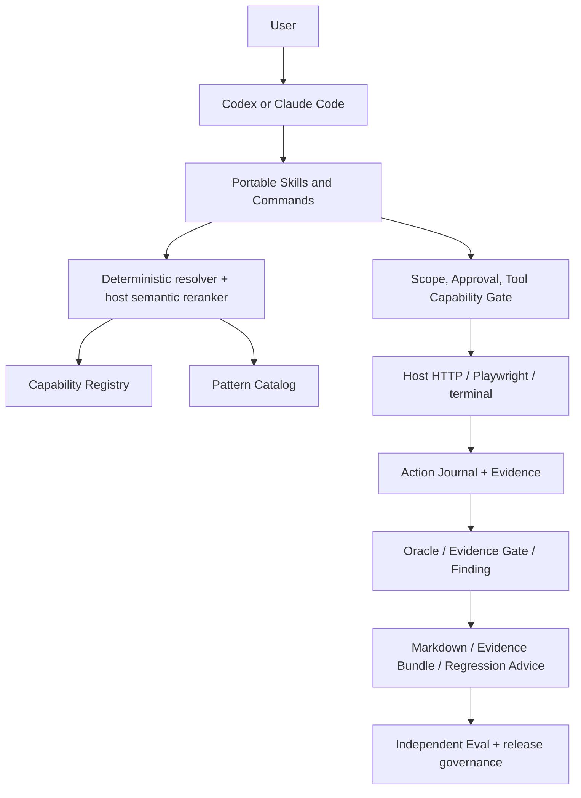

[中文版](../zh-CN/02-architecture.md)

# Architecture Baseline — v0.1

## Scope

Deliver one **complete** MVP release: eleven canonical Skills (five API/business, two browser, orchestration, validation, reporting, regression recommendation), sixteen canonical Patterns, fifty benchmark scenarios, Codex and Claude Code core compatibility, local session recovery and evidence bundles. Vertical slice VS-01 is an intermediate integration checkpoint **within** this release, not a reduced MVP.

## Layers

No independent agent runtime, task queue, server, vector DB or SQLite in MVP. Bounded autonomy is available **only** where action enforcement and real approval can be demonstrated; otherwise degrade to assisted/guided.

## Ownership and boundaries

- Portable Core owns Skill, Pattern, taxonomy, OpenAPI declaration discovery, routing, Oracle, Finding, evidence, report and session contracts.
- Host adapters own only discovery metadata, command exposure and tool/permission mapping; no duplicated business logic.
- Pattern is knowledge; Skill is methodology; Registry is selection; evaluator is independent ground truth.
- Q9 regression outputs are recommendations, not executable code or modifications to project tests.
- Canonical files are local and Git-friendly; raw secret-bearing evidence must be ignored by default.

## Exact catalog

Skills (11): `bug-discovery`, `discover-business-logic`, `discover-boundary-defects`, `discover-state-defects`, `discover-api-contract-defects`, `discover-api-idempotency-defects`, `discover-web-interaction-defects`, `discover-ui-api-inconsistencies`, `bug-validation`, `bug-reporting`, `bug-regression-recommendation`.

Patterns (16): BP-BIZ-001/002/003; BP-STATE-001/002/003; BP-API-001/002/003; BP-BOUNDARY-001/002/003; BP-UI-001/002/003/004. **Alias resolution is mandatory** for the longer illustrative `BP-API-IDEMPOTENCY-001` from prior drafts: assign that mechanism to `BP-API-002`, mark the long form as deprecated alias, never duplicate the canonical content.

## Contradictions resolved

1. Exactly 11 Skills, not 8/10; Q9 added one to Q4's ten.
2. Exactly 16 Patterns, not 12; UI adds four.
3. E0–E4 evidence maturity is orthogonal to Finding lifecycle, reproduction state, reviewer status and severity.
4. Root `.bugmaster/` is the only project data root; per-Finding immutable revisions and `current.json` are authoritative; `finding.json` is generated current view.
5. No guaranteed execution protection from prompt-only policies. The official controlled gateway enforces actions; unsupported host tools are advisory and must not be used for bounded autonomy.
6. G0–G3 comparative groups use the same independent scorer; group G0 must never be scored using only its own weaker gate.
7. Pattern lifecycle `candidate/reviewed/verified/deprecated`; Skill lifecycle `proposed/experimental/candidate/stable/deprecated/retired`.
8. Session and Finding append-only logs have different event domains; use typed IDs and namespaces to avoid collision.
9. CLI syntax, host command syntax and installability are targets, not verified product claims.
