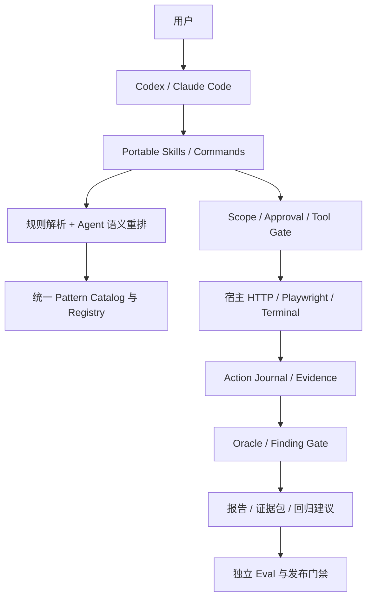

[English](../en/02-architecture.md)

# 架构基线 — v0.1

## 范围与交付

**一次性完整 MVP 版本**包含：11 个 Canonical Skills、16 个 Bug Patterns、50 个 Benchmark 场景、Codex 与 Claude Code 核心兼容、API 优先与基础浏览器、证据包、会话恢复和质量门禁。VS-01 垂直切片只是内部最早集成检查点，**不是缩小范围后的单独 MVP 版本**。

## 架构

MVP 不开发独立 Agent Runtime、Web UI、任务队列、数据库或语义向量检索。若无法在工具路径上实施强制限制，自动执行降级，不承诺 Prompt 具有硬隔离能力。

## 所有权

- Portable Core 唯一维护 Skill、Pattern、Registry、本地 OpenAPI 声明发现、路由、Oracle、Finding、Evidence、Session 契约。
- Codex/Claude Code Adapter 只维护发现、命令和工具/权限映射，不复制核心业务逻辑。
- Pattern 是缺陷知识；Skill 是探索方法；Registry 决定加载；独立评估器根据私有答案裁决。
- Q9 只交付回归建议，不生成或维护自动化测试代码。

## 统一数量与冲突收敛

- **11 Skills**：`bug-discovery`、`discover-business-logic`、`discover-boundary-defects`、`discover-state-defects`、`discover-api-contract-defects`、`discover-api-idempotency-defects`、`discover-web-interaction-defects`、`discover-ui-api-inconsistencies`、`bug-validation`、`bug-reporting`、`bug-regression-recommendation`。
- **16 Patterns**：BP-BIZ-001/002/003；BP-STATE-001/002/003；BP-API-001/002/003；BP-BOUNDARY-001/002/003；BP-UI-001/002/003/004。此前长 ID `BP-API-IDEMPOTENCY-001` 仅作为 `BP-API-002` 的历史别名候选，不允许同时成为第二份权威 Pattern。
- E0–E4 仅表示证据成熟度，与 Finding 状态、复现状态、Review、Severity 分开。
- 数据根目录统一 `.bugmaster/`。不可变 Revision + `current.json` 为权威；`finding.json` 是可重建当前视图。
- Pattern 生命周期 candidate/reviewed/verified/deprecated；Skill 生命周期 proposed/experimental/candidate/stable/deprecated/retired。
- 统一外部评估器判定 G0–G3，避免各实验组使用各自较弱的验证规则。
- 宿主命令与安装命令是待测试的目标，不是已经验证的功能。
