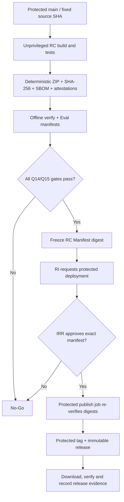

[English](../en/09-release-authorization.md)

# Q16 正式发布授权与供应链保障规范（ADR-016）

> 状态：Accepted as architecture decision / 尚未实施。日期：2026-11-18。Q15 于 2026-11-22 修订为 D；Q16=B。范围：Q14=A 的一次性交付完整 MVP。来源：`RELEASE_POLICY.md`、`docs/zh-CN/07-release.md`、`docs/zh-CN/08-implementation-governance.md`、ADR-015。

## 1. 决策冻结

Q1–Q16：**A,A,B,B,B,B,B,B,A,B,B,B,B,A,D,B**。Q15 要求 Codex 对每个 PR 做代码扫描，对 R2/R3 变更做安全扫描；项目所有者查看结果后手动合并，不要求独立真人 PR 签署。Q16 是独立的 Release Candidate 双人发布授权。没有第二名授权审核者时，允许继续开发并生成候选制品，但正式公开发布必须 No-Go；不得将 Q16 改为自动发布。

## 2. 责任与分离

- **Release Initiator (RI)**：选择已审核的固定源码 SHA、触发候选构建、汇总 RC Manifest 和测试证据、提出 Go/No-Go；可以是 Q15 的 IM/RA。
- **Independent Release Reviewer (IRR)**：与 RI 不同的真实自然人，核查冻结 SHA、Manifest、产物摘要、Attestation、全量基准、BLK-01..07、Q15 扫描证据、兼容性、安装和回滚演练后显式批准或拒绝。
- **Codex Q15 扫描**：每个 PR 做代码扫描，R2/R3 变更还做安全扫描。项目所有者查看结果后手动合并；扫描不替代 Q16 的 IRR 发布批准。
- **Evaluation Custodian (EC)**：证明 Ground Truth 对被测 Agent 不可见、基准可复核，提供签署所需的 Eval Run 引用。
- **Publisher**：仅受环境保护门禁批准后的受限 CI 发布 Job；人不直接使用常设管理令牌向 Release 上传制品。

### 双人签署判定

`release_auth = (RI identity != IRR identity) AND RI request tied to manifest digest AND IRR approval tied to same digest AND all mandatory checks pass AND protected publishing job is authorized`。发布 job 使用的 Commit、Manifest 或 artifact 任一发生变化，必须重新发起授权。GitHub Environment 的 Required reviewers 通常只要求所列审核者中的**一名**通过；Q16 的双人模型以“发起人 + 不同的批准人”为两名，启用 **Prevent self-review**，不是要求两名 reviewer 投票。如果未来要求两位独立 Reviewer 均签字，应另加可验证策略/自定义保护规则，不能仅靠配置多个 Required reviewers 实现。

## 3. GitHub 环境配置（按当前 GitHub 官方文档能力验证）

1. 创建 `release-production` Environment，开启 Required reviewers，绑定受信任的发布审核人/团队，并开启 **Prevent self-review**。
2. 启用 **Prevent admins from bypassing configured protection rules**（若仓库 UI/计划支持），并限制可部署的分支/Tags；确认实际账号权限和公私有仓库计划是否支持所需保护。
3. 为默认分支和 `v*` Tag 建立 Ruleset，按需要求 PR 审核、状态检查、阻止未经授权的 Tag 更新/删除、限制绕过主体。
4. 如果仓库可用，启用 **Immutable Releases**；一旦公开发布则不得依赖修改现有 Release 资产或移动 Tag 进行“修复”。
5. 建立环境前先在测试仓库验证保护规则是否真正阻断 Job；配置缺失或 GitHub 计划不支持时 **No-Go**，不能用文档承诺代替强制执行。

## 4. 分离 CI：构建 → 证据 → 审核 → 发布

不在带发布写权限的 Job 中执行不可信 Pull Request 的代码；将测试/构建 Job 与发版 Job 分离。候选制品应由低权限 Job 生成，发布 Job 只下载并验证冻结制品，必要时发布只读验证后签署证明。不得在高权限 `pull_request_target` 环境检出并执行外部 PR 的任意脚本。

## 5. 供应链、Tag 与 Artifact 签署

- GitHub Actions：默认 `permissions: contents: read`，每个 Job 单独授予最小权限；第三方 Actions 固定到完整 Commit SHA，依赖锁定并扫描；Fork PR 无发布密钥与可写 Token。
- 产物：为 Portable Bundle、11 个 Standalone Skills、Host Adapter、源码及报告生成稳定 Digest、SBOM/依赖清单、Source Commit、构建工作流 Run ID 和 Dataset Digest。规范化 ZIP 时间戳/排序/路径以利可重复构建。
- **Artifact Attestation**：在受控构建流程中使用 GitHub 提供的 Attestation/OIDC 证明来源；使用 `gh attestation verify <artifact> -R <owner/repo>` 核验发布制品、来源仓库与关联工作流。验证证明的是制品与其构建身份/来源关联，不证明其中逻辑无漏洞。
- **Tag 防护**：`v0.1.0` 只指向审核通过的固定 SHA；优先使用受保护 Tag + Immutable Release。签名 Git Tag、构建 Attestation、Release 审批记录是独立信任维度；如要求加密签名 Tag，应另外验证签名密钥/签名身份的管理机制，不能把 Attestation 冒充签名 Tag。
- GitHub 的 Immutable Release 在发布之后保护 Release/相关 Tag/资产不被修改（具体支持以实际设置为准）。撤回有问题版本时发布安全公告和替代版本，不覆盖既有制品。

## 6. 最小 Release Manifest 契约

字段：`schemaVersion`, `releaseId`, `version`, `sourceCommit`, `sourceTreeDigest`, `workflowRunId`, `datasetDigest`, `requiredScope` (11 Skills,16 Patterns,50 cases,2 hosts), `qualityEvidenceRefs`, `codeScanRefs`, `securityScanRefs`, `blockingSpikeRefs`, `artifactDigests`, `attestationRefs`, `riIdentity`, `irrIdentity`, `approvalManifestDigest`, `approvalDecision`, `publishedTag`, `postPublishVerification`。所有审批必须绑定不可变 Manifest Digest，未绑定则无效。`approvalDecision` 必须由 GitHub 环境审核/经过身份验证的批准动作生成，不能由模型手填。

## 7. 发布权限矩阵

| 操作 | RI | IRR | CI build | Protected publish job |
|---|---|---|---|---|
| 提议 RC / 记录测试证据 | 允许 | 只读复核 | 构建证据 | 不修改 |
| 批准正式发布 | 禁止自批 | 允许，且需独立身份 | 禁止 | 验证批准 |
| 读取 Ground Truth | 默认禁止 | 最小按需 | 隔离评估器 | 禁止 |
| `contents: write` / 发布 Release | 无直接常设凭据 | 无需写凭据 | 禁止 | 限定发布步骤 |
| 发布后更换资产或移动 Tag | 禁止 | 禁止 | 禁止 | 禁止 |

## 8. Go/No-Go 决策

全部为 Go 条件：Q14 全量范围（11/16/50/2 + API/Browser）完成；Q15 W0–W11 DoD 与适用的代码/安全扫描证据齐全；BLK-01..07 已关闭；契约、安全、Evidence、Safe Resume、独立安装与双宿主真实 Run 通过；G0–G3 Eval 有实际分子/分母、用量成本和失败案例；英文/中文文档、许可证、SBOM、签署/Attestation、回滚演练完成；RI != IRR 且 IRR 在冻结 Manifest 上签署批准；发布 Job 二次核验 SHA 和摘要。任何关键安全、证据或权限保护不足则 No-Go，不以风险接受绕过。

## 9. 失败与回滚

- **审核前构建失败**：丢弃 RC，纠正后以新 Build ID 重新生成完整证据。
- **批准后 SHA/Digest 变化**：立即撤销既有批准，生成新 RC，重新审核。
- **部分发布失败**：停止发布，禁止以不同内容复用已对外公开的版本号/Tag。根据 Immutable Release 状态作差异化处理；保留失败日志。
- **发布后安全缺陷**：标记受影响能力为不安全、发布 Security Advisory / 修复版本、指导用户切换到最后可信版本。不得修改已签名或不可变制品。
- **数据回滚**：不删除用户 `.bugmaster/` Finding / Evidence / Session；旧版 Schema 不兼容则只读或拒绝写入，用户数据恢复遵循 Q8/Q13 的快照语义。
- **审批资源不足**：公开发布保持 No-Go；允许继续本地 TDD、构建 RC 和受控测试。

## 10. TDD / Eval（Q16 新增）

| ID | 用例 | 期望 |
|---|---|---|
| RELAUTH-001 | RI 尝试审批自己的部署 | GitHub 环境阻断 |
| RELAUTH-002 | 多名 required reviewers 但无人审批 | 发布阻断 |
| RELAUTH-003 | 审核人在批准后修改 Manifest | 发布 Job 拒绝 |
| RELAUTH-004 | 提交 SHA 与 RC Manifest 不一致 | 阻断 |
| RELAUTH-005 | 资产 Hash 不一致 | 阻断 |
| RELAUTH-006 | 缺少或无法验证 Attestation | 阻断正式发布 |
| RELAUTH-007 | Fork PR 尝试读取发布凭据 | 凭据不可达 |
| RELAUTH-008 | 未经批准的 Tag/Release 创建 | Ruleset/权限阻断 |
| RELAUTH-009 | R2/R3 改动缺适用的 Q15 代码/安全扫描证据 | No-Go |
| RELAUTH-010 | 发布 job 未通过 protected environment | 无法发布 |
| RELAUTH-011 | Immutable Release 后尝试替换资产 | 拒绝并改走新版本修复 |
| RELAUTH-012 | 发布后下载并核验证据 | Digest/来源/Tag 均一致 |
| RELAUTH-013 | 回滚时新旧数据 Schema 不兼容 | 只读或拒绝写入，不删除证据 |
| RELAUTH-014 | 唯一维护者没有第二签署人 | No-Go |
| RELAUTH-015 | 无权限的 workflow 获得 `contents: write` | 静态策略测试失败 |
| RELAUTH-016 | 已批准 RC 的评估版本变化 | 必须重新 Eval 与签署 |

CI 静态/合约测试每 PR 执行；发布流程在隔离测试仓库进行至少一次完整 Dry Run（包含自审被拒、Tag 防护、产物核验、模拟失败/回滚）。本文件**不代表 GitHub Environment 已建立、CI 已执行或实际签署已完成**。

## 11. 对 W0–W11 的增量任务

- **W0**：冻结 ADR-016，明确 Q15 PR 扫描与 Q16 双人发布授权的边界。
- **W1**：实现 Release Manifest / Sign-off / Attestation / Rollback Event Schema。
- **W9**：导出冻结 Benchmark / Eval Run Digest 和评分口径。
- **W10**：发布包来自经验证的两宿主适配器与固定源码。
- **W11**：Environment/Ruleset、低权限 CI、构建签署与二次核验、Dry Run、公告与回滚文档。

**当前判定：Conditional Go for implementation / No-Go for public release**。Q16 关闭后停止非阻断性架构提问，进入正式仓库初始化、27 项 Issues 和 W0–W11 TDD 实施。
